# Access Management — User Guide (Odoo 20.0)

A complete, step-by-step guide to configuring and using the **Access Management**
module. It explains every screen, every option, the order in which to do things,
and — importantly — *how strongly each option is enforced* so you know what is a
real security boundary and what is only a UI convenience.

---

## 1. What this module does

Access Management lets an administrator tailor **what each user (or group) can
see and do** — without writing XML or Python. From one place you can:

- Hide menus and apps.
- Restrict Create / Edit / Delete and Archive / Duplicate / Export / Import per model.
- Limit which **records** a user can read/write/create/delete (record rules via domains).
- Make fields invisible, read-only or required (optionally only under a condition).
- Hide buttons, notebook tabs, kanban links and specific view types.
- Hide or restrict the chatter (messages, log notes, activities, followers…).
- Control users directly: view-only, prevent login, disable developer mode, block the external API, force password expiry.
- Bundle security groups into **Roles** and grant them to many users in two clicks.
- **Mass-assign** groups / roles / rules to many users at once.
- Audit logins, review a restriction **dashboard** (pivot + graph), and print a
  per-rule **PDF** summary.
- **Export/Import** the whole configuration between databases.

### 1.1 Enforcement levels (read this first)

Throughout this guide each option is tagged with how it is enforced:

| Tag | Meaning |
|-----|---------|
| 🔒 **Hard (server)** | Enforced on the server for **both the web UI and the external API (XML-RPC/JSON-RPC)**. A real security boundary — cannot be bypassed by a technical user. |
| 🖥️ **Server-rendered UI** | The control is removed/changed in the view *on the server* before it reaches the browser. Reliable for the UI, but it governs presentation, not the data layer (combine with 🔒 options for true data security). |
| 🌐 **Client only** | Done in JavaScript/CSS in the browser. Cosmetic — appropriate for tidying the interface, not for security. |

> **Golden rule:** to truly stop a user touching data, use **Create/Edit/Delete
> permissions** and **record domains** (both 🔒). Hiding fields/buttons/menus is
> mostly presentation.

---

## 2. Concepts

The module has two independent building blocks:

1. **Access Rules** (model `access.management`) — a "profile" that targets some
   users/groups and applies a bundle of restrictions to them. A user can be hit
   by several rules at once. UI hides and hard CRUD denials accumulate. Configured
   record domains from different profiles are combined with OR, then intersected
   with native Odoo access; they never grant access denied by Odoo itself.

2. **Security Roles** (model `access.role`) — a reusable bundle of *security
   groups* you grant to users (optionally for a date range). Assigning a role
   **adds** its groups to the user; removing/expiring it **removes exactly those
   groups** and leaves the user's other groups untouched.

These are complementary: Roles decide **which standard Odoo groups** a user has;
Access Rules **fine-tune the UI and data access** beyond what groups allow.

---

## 3. Prerequisites & installation

- Odoo **20.0 Community or Enterprise** (depends on `base`, `web`, `mail`).
- Install the module from **Apps** (search "Access Management").
- After install you get a top-level **Access Management** app menu.

### 3.1 Who can configure it

Only members of the **Access Management / Administrator** group
(`access_management_ai.group_access_manager`) can see and edit the configuration.
This group implies *Settings* (`base.group_system`), so grant it only to trusted
administrators.

> The administrator who configures rules is **not** exempt from them automatically —
> rules apply to whoever they target. The technical superuser (`__system__`) and
> users in *Settings* are skipped by most checks to avoid lock-outs, but test with
> a normal user account.

---

## 4. The Access Management menu

Open the **Access Management** app. You will find:

| Menu | Purpose |
|------|---------|
| **Access Rules** | Create and manage restriction profiles. |
| **Roles** | Define security roles and grant them to users. |
| **Dashboard** | Pivot + graph heatmap of how many restrictions hit each model. |
| **Mass Assignment** | Add/remove/replace groups, roles or rules on many users. |
| **Login Audit** | Login / logout / failed-login history. |
| **Import / Export** | Move the configuration between databases (JSON). |

---

## 5. Step-by-step: create an Access Rule

**Access Management ▸ Access Rules ▸ New.**

### Step 1 — Name and target the rule

- **Name** — e.g. *"Salesperson restrictions"*.
- **Users** — the specific users this rule applies to.
- **Groups** — every member of these groups is subject to the rule.
- **Companies** (multi-company only) — limit the rule to these companies; leave
  empty to apply in every company. 🔒
- **Sequence** — ordering when several rules exist.

You can also target users *automatically* (in the **Apply To & Controls** box):

- **All Internal Users** — applies to every current and future internal user.
- **All Portal Users** — applies to every current and future portal user.

> A rule with no Users/Groups and neither "All …" flag applies to nobody.

### Step 2 — Apply To & Controls

- **Disable Developer Mode** — forces debug mode off for the targeted users. 🔒
  (the server blanks the debug flag in the session; the superuser is exempt).
- **Password Expiry (days)** — targeted users must reset their password after
  this many days (0 = never). The smallest positive value across a user's rules
  wins. 🔒 (enforced at login).
- **Hidden Systray Items** — comma-separated systray registry **keys** to hide
  from the top-right system tray (e.g. `mail.messaging_menu`). 🌐 (tip: enable
  developer mode to discover an item's registry key).

### Step 3 — Schedule (time & timezone)

Make the whole rule active only within a window:

- **Active From / Active Until** — calendar dates/times. Outside the window the
  rule does not apply. A rule past its **Active Until** is also auto-archived by
  a scheduled job. 🔒
- **Timezone**, **Daily From**, **Daily To** — restrict the rule to a daily time
  window (e.g. 09:00–18:00). Supports windows that cross midnight. 🔒

> The schedule is evaluated live on every request (never cached), so it always
> reflects the current time.

### Step 4 — Menus tab

- **Hidden Menus** — pick menus/apps. The selected menus **and all their
  sub-menus** disappear for the targeted users. 🔒

### Step 5 — Models tab

Add one line per model you want to restrict. Each column:

**Permissions (hard):**
- **Create / Edit / Delete** — untick to deny that operation on the model. 🔒
  (applies to UI *and* API).

**Buttons / actions:**
- **Archive** — untick to hide Archive/Unarchive in the list Actions menu. 🌐
- **Duplicate** — untick to remove Duplicate. 🖥️
- **Export** — untick to remove list **Export**. 🖥️
- **Hide Import** — hides the Import button. 🖥️
- **Hide Insert in Spreadsheet** — 🌐 hides supported spreadsheet insertion
  actions when the spreadsheet app is installed.

**View types — untick/tick to hide a view mode from the model's action:** 🔒
- Hide **List / Form / Kanban / Calendar / Pivot / Graph / Gantt / Map / Activity**.
  (Removed from the action server-side, so the view simply isn't offered.)

**Search controls:**
- **Hide Filters / Group By / Favorites** — 🌐 (Favorites is also enforced
  server-side: saved filters are withheld). 
- **Hide Search Panel** — removes the left search panel. 🖥️
- **Hide Search Bar** — hides the search input entirely. 🌐
- **Hide Add Property** — disables adding/editing custom properties, including the
  **Add Property** button (for models that use the Properties field). 🌐

**Per-model chatter** (override the global Chatter tab for this model): 🌐 (full
"Hide Chatter" is 🖥️)
- Hide Chatter, Send Message, Log Note, Activities, Followers, Attachments, Search Messages.

**Record-level access (record rules) — the strongest data control:** 🔒
- **Read / Write / Create / Delete Domain** — an Odoo domain that limits *which
  records* the user may read/write/create/delete. Example: only own records →
  `[('user_id', '=', uid)]`. Helper variables available in the domain: `user`,
  `uid`, `company_id`, `company_ids`, `time`.
- **Soft Restrict** — apply the domains only to this exact model, without
  cascading to inherited/related models.

> Invalid domains are rejected when saving. If a stored expression fails during
> evaluation, it fails closed rather than exposing records. Test domains using a
> restricted user before broad assignment.

### Step 6 — Fields tab

One line per field (pick the **Model**, then the **Field**). All field options
are 🖥️ (server-rendered into the view):

- **Invisible / Read-only / Required** — force the modifier on.
- **Invisible If / Read-only If / Required If** — instead of always, apply only
  when a Python condition is true, e.g. `state == 'done'`. (If you tick the
  boolean *and* give a condition, the condition controls when it applies.)
- **Remove Internal/External Link** — for relational fields, removes the "open"
  (→) button.
- **Disable Create/Create & Edit** — for relational fields, removes the quick
  "Create" options from the dropdown.
- **Dropdown Domain** — for relational fields, restricts the selectable records
  with a domain.

Conditions are OR-combined with any condition already on the field in the base
view, so you tighten, never loosen.

### Step 7 — UI Elements tab

Hide individual buttons / tabs / kanban links. One line each:

- **Model**, **View** (Form / List / Kanban / Any).
- **Element Type** — Button, Notebook Page/Tab, Field Element, or Kanban Link.
- **Name / Label** — match the node's technical `name` **or** its visible label.
- **Invisible If** — a condition; leave empty to always hide.

All 🖥️. Tip: enable developer mode to read a button's technical `name`, or just
type its visible caption.

### Step 8 — Reports & Actions tab

- **Hidden Reports** / **Hidden Actions** — removed from the **cog (⚙️) Print /
  Action** menu for the targeted users. 🖥️

### Step 9 — Chatter tab (global)

Profile-wide chatter switches (a fallback applied to **all** models for the
targeted users), overridable per-model in the Models tab:

- Hide Chatter (🖥️), Hide Send Message / Log Note / Activities / Followers (🌐).

### Step 10 — Save

Save the rule. Changes take effect immediately — the module clears the relevant
caches on every create/write/unlink of a rule. Affected users may need to
refresh their browser for view/menu changes to show.

---

## 6. Step-by-step: Security Roles

**Access Management ▸ Roles ▸ New.**

1. **Name** the role (e.g. *"Warehouse Manager"*) and optionally add a
   **Description**.
2. **Groups tab** — pick the security groups this role should grant. 🔒
3. **Included Roles tab** (optional) — pick other roles; their groups are also
   granted (composition / nesting).
4. **Users tab** — add the users who should have this role. For each line you may
   set **From / To** dates to limit when the role is active. The **Active Now**
   column shows whether the line is currently in force.
5. **Save.**

What happens on save (all 🔒 — real group membership changes):

- Each listed user immediately **receives the role's groups** (plus included
  roles' groups).
- If you **archive** the role, set it inactive, **remove a user line**, **drop a
  group from the role**, or a line's date window **expires**, exactly those
  groups are **removed** from the affected users — their other (manually
  assigned) groups are preserved.
- A nightly scheduled job re-applies role groups so **date-limited** roles
  activate/expire automatically.

You can also assign roles from the **user form** (see §8) and via **Mass
Assignment** (see §7).

> Use the **# Users** stat button on the role form to jump to its members.

---

## 7. Step-by-step: Mass Assignment

Grant or revoke things for many users at once.

**Access Management ▸ Mass Assignment** — or select users in **Settings ▸ Users**
and use the **Action ▸ Mass Assignment** menu.

1. **Users** — the target users (pre-filled if launched from the Users list).
2. **Operation:**
   - **Add** — grant the selection on top of what users already have.
   - **Remove** — revoke the selection from the users.
   - **Replace** — for **groups**, set exactly the selected groups (roles/rules
     are upserted).
3. Pick any combination of:
   - **Groups** — security groups. 🔒
   - **Roles** — security roles (with optional **Role From / To** dates). 🔒
   - **Access Rules** — add/remove users from a rule's target list.
4. **Apply.** You are redirected to the affected users.

---

## 8. User-level controls (on the user form)

Open **Settings ▸ Users ▸ [a user] ▸ Access Management tab** (visible to Access
Management administrators).

**Buttons:**
- **Login as** — switch your session to this user (audited). Admins only; you
  cannot log in as the superuser. 🔒
- **Terminate Sessions** — log the user out of all their devices/sessions. 🔒

**User Controls:**
- **View Only** — the user can browse but cannot create/edit/delete/export
  business records. 🔒 (writes to business models are blocked server-side;
  technical models like preferences still work so the UI doesn't break).
- **Prevent Login** — blocks new logins (existing sessions continue until they
  end). 🔒
- **Disable Developer Mode** — forces debug off for this user. 🔒
- **Block External API** — blocks XML-RPC/JSON-RPC/external API authentication
  while still allowing interactive web login. 🔒

**Password:**
- **Password Last Changed** / **Password Expires On** — informational; expiry is
  driven by the Password Expiry setting on the rules targeting the user. A
  scheduled job emails reminders 7 days and 1 day before expiry.

**Roles** — grant/revoke this user's roles inline (with optional date windows),
the same data as the role's Users tab.

---

## 9. Reports, dashboard & analysis

The module ships three complementary ways to review your configuration:

### 9.1 Dashboard — Pivot heatmap

**Access Management ▸ Dashboard** opens the analysis model
`access.management.report` (a read-only SQL view) in a **Pivot** showing how many
restrictions each model carries, per rule. Use it to spot heavily-restricted
models, drill down by model/rule, and audit your setup at a glance. Measures and
groupings can be pivoted freely like any Odoo pivot.

### 9.2 Dashboard — Graph (bar chart)

The same Dashboard action also offers a **Graph** view (bar chart) of the
restriction counts — switch using the view-type buttons at the top right. Useful
for a quick visual comparison across models.

### 9.3 Printable PDF report — "Access Rule"

From any rule (**Access Management ▸ Access Rules ▸** open a rule), use
**⚙️ Print ▸ Access Rule** to generate a **PDF** summary of that profile,
including:

- Header (name, archived flag, sequence).
- **Applies To** (users, groups, companies, all-internal/all-portal flags).
- **Controls & Schedule** (developer mode, password expiry, systray, active /
  daily windows).
- **Hidden Menus**.
- **Model Restrictions** table — Create/Edit/Delete, Archive/Duplicate/Export/
  Import (✓/✗), hidden view types, and record domains.
- **Field Restrictions** and **Hidden UI Elements** tables.
- **Hidden Reports & Actions** and the global **Chatter** settings.

The report prints in **landscape A4** so the wide model table fits, and is ideal
for documentation, change reviews or audit sign-off. You can also select several
rules in the list and print them together.

---

## 10. Login Audit

**Access Management ▸ Login Audit** — a read-only log of **Login / Logout /
Failed Login** events with date, user, login, IP, browser and platform. Filter by
event type and group by user/event/date. Useful for security reviews.

---

## 11. Import / Export configuration

**Access Management ▸ Import / Export.**

- **Export:** pick profiles (or leave empty to export **all**), click **Export**,
  download the generated `access_profiles.json`.
- **Import:** upload a previously exported JSON file and click **Import**. Rules
  are recreated; users are matched by **login**, groups/menus/reports/actions by
  their external IDs, and model/field lines by model & field name.

This is the recommended way to move access configuration from a **staging** to a
**production** database.

---

## 12. Scheduled actions (automation)

The module ships three crons (Settings ▸ Technical ▸ Scheduled Actions):

| Cron | What it does | Frequency |
|------|--------------|-----------|
| **Revoke Expired Profiles** | Archives rules whose *Active Until* has passed. | hourly |
| **Password Expiry Reminders** | Emails users 7 days and 1 day before expiry. | daily |
| **Sync Role Groups** | Re-applies role groups so date-limited roles activate/expire. | daily |

---

## 13. Typical workflows (recipes)

**A. A read-only auditor user**
1. Open the user ▸ Access Management ▸ tick **View Only**. Done (🔒).

**B. Salespeople see only their own orders**
1. Access Rules ▸ New ▸ target the *Sales / User* group.
2. Models tab ▸ add `sale.order` ▸ set **Read Domain** `[('user_id', '=', uid)]`.
3. Save. (🔒)

**C. Hide a whole app from some users**
1. Access Rules ▸ target the users ▸ Menus tab ▸ add the app's top menu. Save. (🔒)

**D. Temporary access for a contractor**
1. Roles ▸ create a role with the needed groups.
2. Add the contractor on the Users tab with **From/To** dates. Save. (🔒, auto-expires)

**E. Onboard a new department**
1. Mass Assignment ▸ select the users ▸ **Add** ▸ choose the relevant **Role(s)**
   and/or **Access Rule(s)** ▸ Apply.

**F. Lock the UI for a kiosk-style profile**
1. Access Rules ▸ Models tab: untick Create/Edit/Delete, hide unwanted view
   types; Fields/UI Elements tabs: hide what's not needed; Chatter tab: Hide
   Chatter. Save.

---

## 14. How enforcement works (under the hood)

For administrators who want to understand the mechanics:

- **CRUD and record domains** → injected into Odoo 20's unified
  `Base._access_domain` (AND-ed with Odoo's native `ir.access` rules).
- **Menus** → `ir.ui.menu._visible_menu_ids` subtracts hidden sub-trees.
- **View types** → `ir.actions.act_window.read` strips hidden modes from the
  action.
- **Fields / UI elements / chatter / search panel / root attrs (create, edit,
  delete, duplicate, export, import)** → the view arch is post-processed in
  `Base.get_view` per user.
- **Reports/Actions in the cog menu** → filtered in `Base.get_views` toolbar.
- **Login / API / password expiry** → `res.users._check_credentials`, plus
  `res.users.apikeys._check_credentials` for Odoo 20 JSON-2 bearer authentication.
- **Developer mode / per-model UI payload** → shipped to the browser in
  `ir.http.session_info` and consumed by small client patches (chatter, archive,
  search menus).
- **Roles → groups** → reconciled in `res.users._access_roles_sync_groups`.
- Results are cached per user and invalidated automatically when you change a
  rule/role; the schedule is evaluated live, never cached.

---

## 15. Tips, gotchas & FAQ

- **Changes don't show?** Ask the user to refresh the browser; view/menu output is
  cached client-side after the server cache is cleared.
- **Don't lock yourself out.** Settings/superuser users are largely exempt, but
  always verify a rule with a normal test account (or use **Login as**).
- **Multiple rules stack.** If two rules target the same user, the strictest
  setting applies (a denied permission anywhere wins).
- **Hiding ≠ securing.** Hidden fields/buttons/menus are presentation. For real
  security use **Create/Edit/Delete** and **record domains** (🔒).
- **Domains are sandboxed.** Only `user`, `uid`, `company_id`, `company_ids`,
  `time` are available; bad domains are ignored (and logged), not fatal.
- **Roles vs. manual groups.** Roles only manage *their own* groups; groups you
  set by hand on a user are never touched by role sync.

---

## 16. Known limitations (transparency)

- **Hide Insert in Spreadsheet** (Models tab) — the only option that is stored but
  has **no effect yet** (no client wiring); it is also not applicable to plain
  Community, which has no spreadsheet button.

Everything else listed in this guide is implemented. The server-enforced controls
are covered by the module's automated test suite (install + upgrade verified on
Odoo 20.0 CE); the client-side (🌐) controls are cosmetic UI tweaks delivered via
the web assets.

---

## 17. Process flow charts (visual reference)

The diagrams below use **Mermaid** and render automatically on GitHub, GitLab,
VS Code (with a Mermaid extension) and most modern Markdown viewers. Each chart
documents one process exactly as the module behaves.

### 17.1 Which tool should I use?

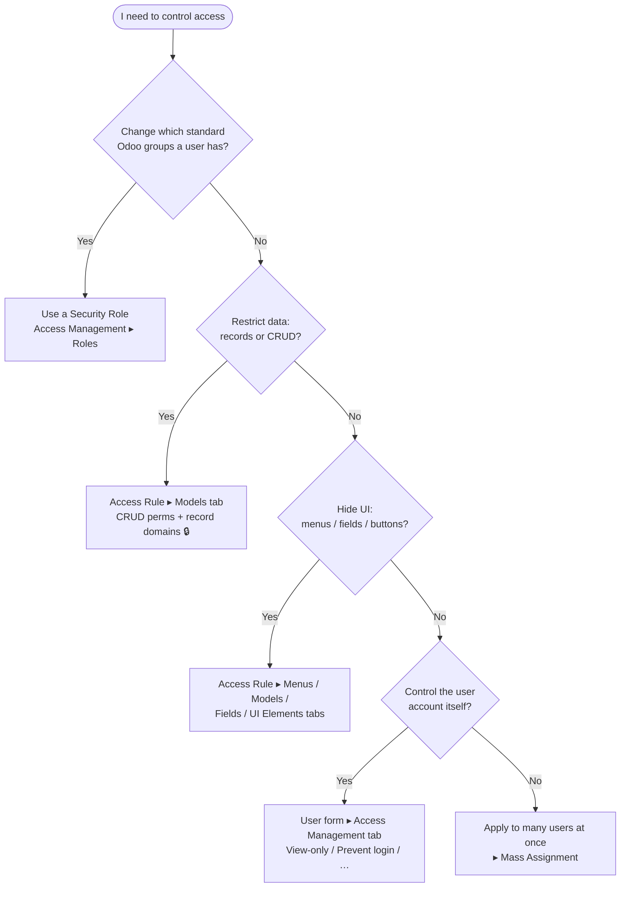

### 17.2 Process A — Create and apply an Access Rule

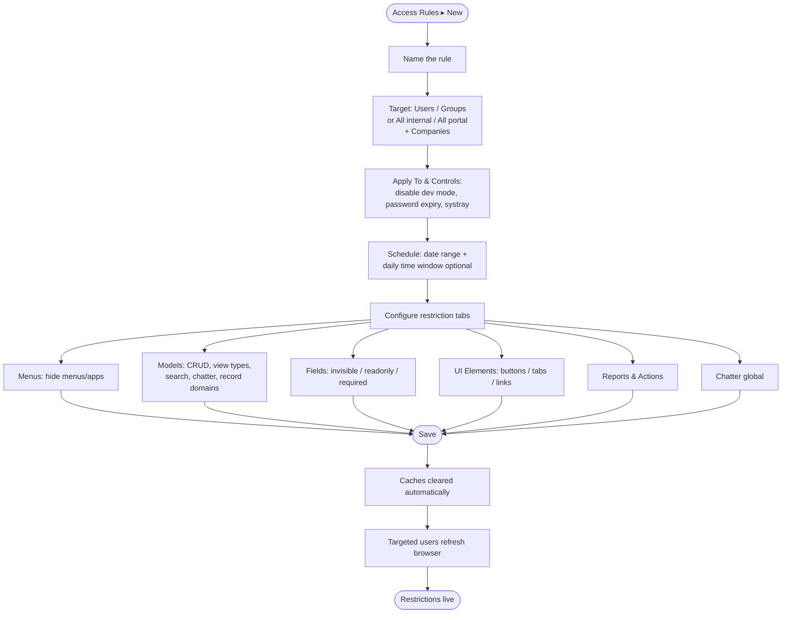

### 17.3 Process B — How a rule is enforced on every request (runtime)

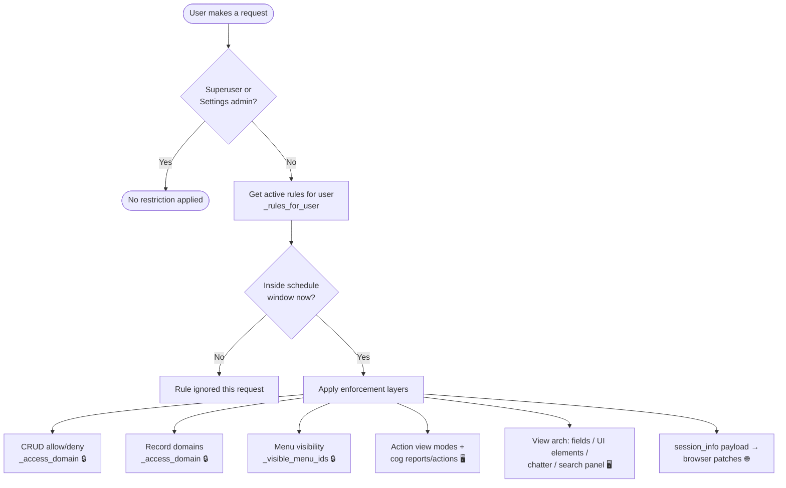

### 17.4 Process C — View rendering pipeline (`get_view`)

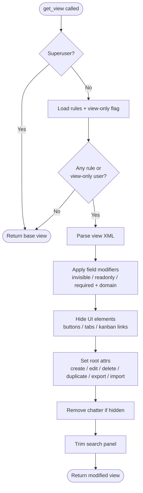

### 17.5 Process D — Security Role ➜ group synchronization

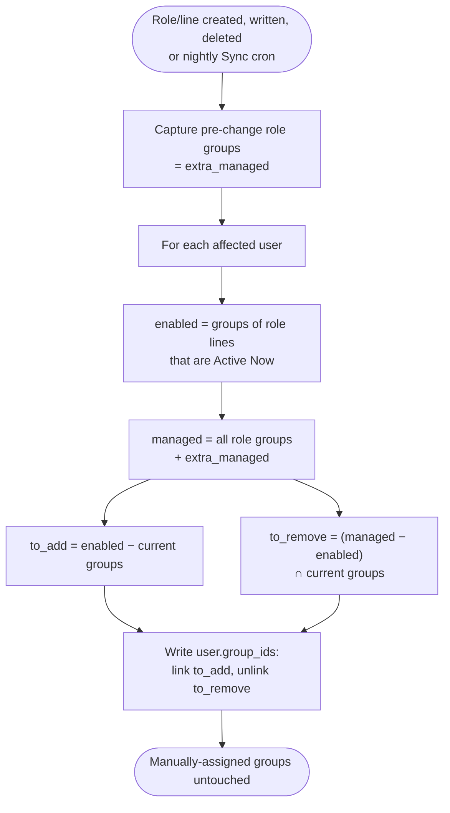

**“Active Now” decision for a role line:**

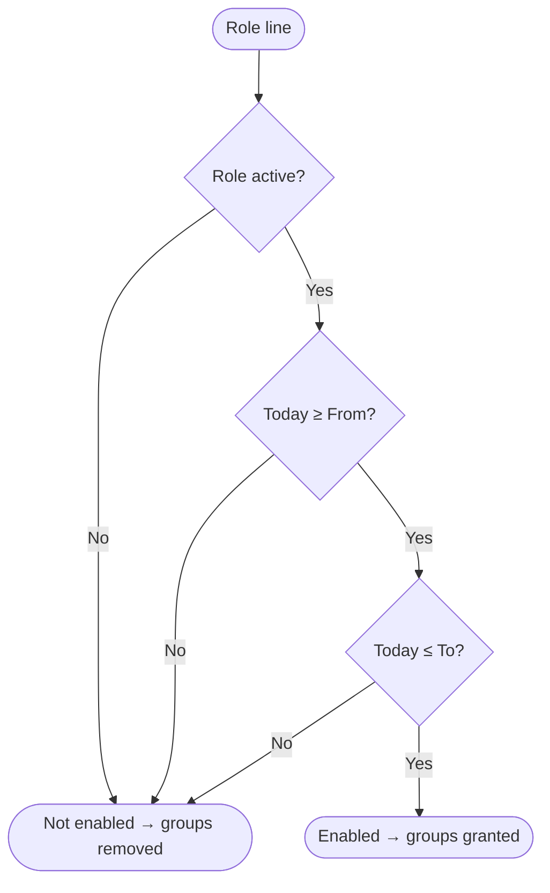

### 17.6 Process E — Mass Assignment

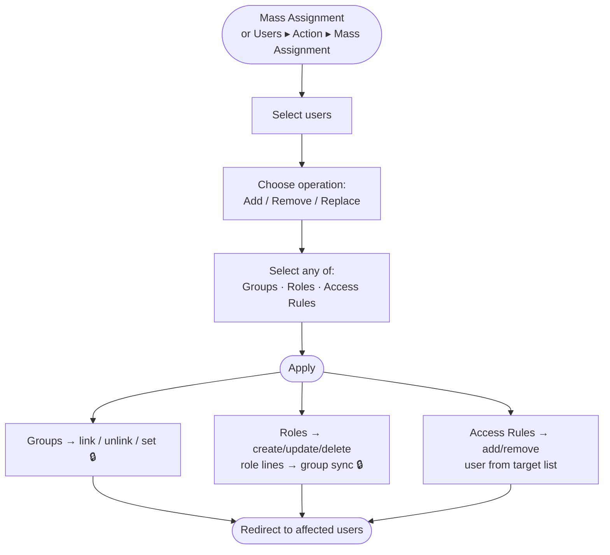

### 17.7 Process F — Login / authentication enforcement

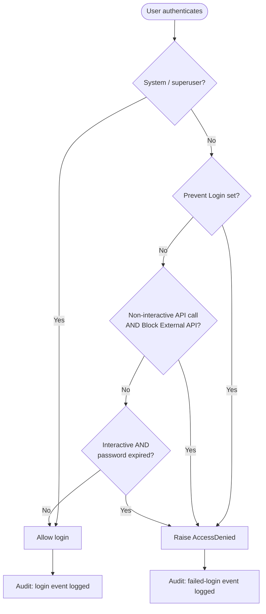

### 17.8 Process G — Import / Export configuration

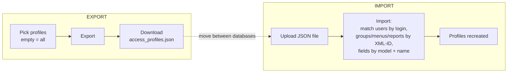

### 17.9 Scheduled jobs (automation timeline)

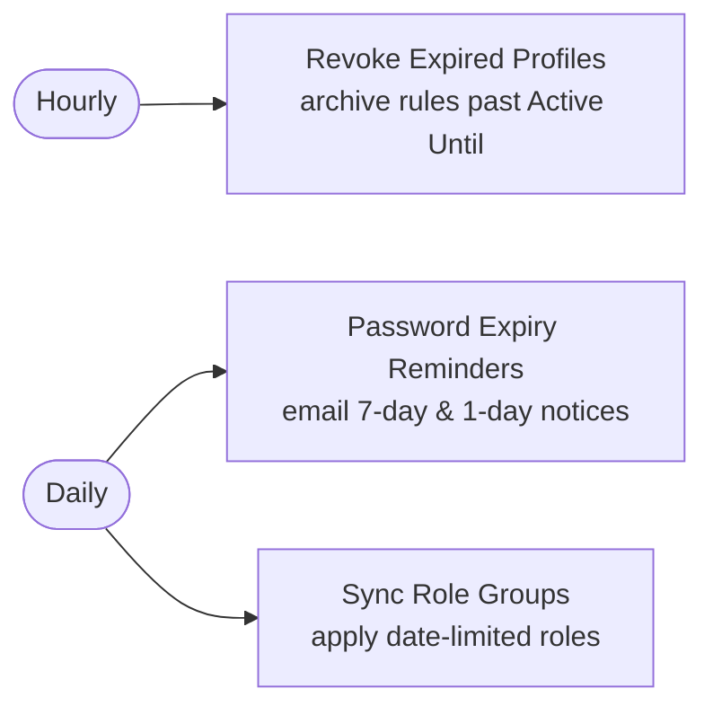

### 17.10 Reporting & analysis

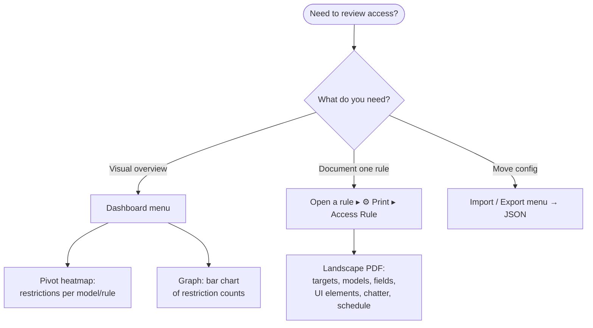

## 18. Extended restrictions

The extended access controls are configured directly on
an access rule.

### 18.1 Global controls

The **Global UI Restrictions** group applies Import, Export, Spreadsheet,
Filters, Group By, Favorites, Search Panel, Add Property, Delete and selected
chatter controls across all models targeted by the rule. `Global Hidden Buttons /
Tabs / Links` accepts a comma-separated list of technical names or labels.

These are UI restrictions unless a model CRUD or record rule is also configured.
Export is additionally enforced on the server: a user cannot bypass a disabled
model export through RPC.

### 18.2 Field export restrictions

On a field rule, **Exclude From Export** removes the field from the model export
field list. Invisible fields are also excluded from export for the targeted user.

### 18.3 Date filters

On a model restriction, set **Date Filter Field** to a technical Date/Datetime
field and choose Today, Yesterday, This Week, Last Week, This Month, Last Month,
This Year or Last Year. The generated domain is applied to the model's access
operations and uses the user's contextual date.

### 18.4 Hierarchy access

For models using Odoo's supported parent hierarchy, configure **Hierarchy Parent
Field** (normally `parent_id`), **Hierarchy User Field** (for example `user_id`)
and a scope of **User Record and Descendants** or **User Record and Ancestors**.
The rule then limits records using Odoo's hierarchy operators. Invalid field
combinations are ignored safely. **Hide Hierarchy View** removes the hierarchy
view mode from the affected action.

### 18.5 Module and action restrictions

**Block Module Install / Update / Uninstall** is enforced on `ir.module.module`
operations, including RPC writes and immediate actions. When enabled, Apps stays
available for browsing, while Activate, Upgrade and Uninstall controls are removed
from its kanban, list and form views. Update Apps List and Import Module menus are
hidden. Module toggles in Settings become read-only; requests that attempt to
change modules through Settings are rejected. ZIP/industry imports are checked
before import processing elevates privileges. This option works independently
of Global Read-Only. Save the rule and refresh the affected user's session.

Hidden actions cover
window, server, client and URL actions in addition to reports.

### 18.6 Read-only profiles and conditional fields

Save the profile after enabling **Global Read-Only** and refresh the affected
user's open browser session. Business record creation, editing and deletion are
blocked on the server. Import, export, archive and property creation controls
are hidden, and module install/update/uninstall operations are also blocked.

Record-dependent field conditions apply in record views. Fields needed to
evaluate those conditions are loaded invisibly. Conditional field rules do not
apply to the search bar, which has no current record; use the search restrictions
to control filters and search controls. Unconditionally hidden fields remain
hidden in search views too.

### 18.7 Roles and access request ownership

New role assignments track the groups they add, preserving groups that the user
already had. A group shared by multiple roles stays until its last role grant
ends. Archiving a nested role disables the grants from that branch.

Submitted request targets and dates cannot be changed. Revoke an approved
request before deleting it. Revocation removes the assignment created by that
request and preserves pre-existing manual profile membership or another valid
request for the same profile. A request for an already assigned role must be
handled by updating the existing role assignment.

Future profile requests are activated, and expired requests are removed, by the
scheduled access-request job. The default daily schedule means these transitions
occur when that job next runs. Daily rule windows may span midnight.
